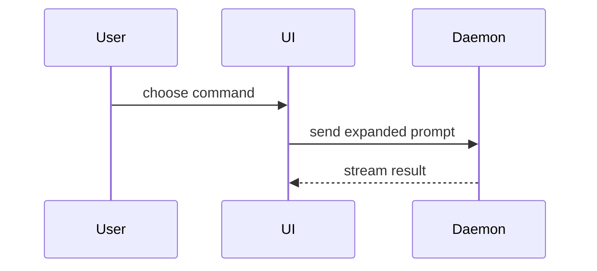

## Workflow

1. Read the repository's PR template and the complete diff against the intended base. Preserve repository headings and checklists. Add the sections below within that structure where appropriate.
2. Identify the problem, demonstrable outcome, and whether the change achieves that outcome completely. Include closing issue references only when applicable.
3. Describe the user or system impact without N/F/O prefixes. Write Overview before Verification as a focused file-and-symbol tree in a `diff` fence: descriptive root, filenames by default, actual symbols with `//` role comments, and before/after behavior leaves for changed implementations.
4. Collect observed verification results and applicable artifacts. Keep automated commands and results under Tests, collapsed in `<details>`. Put Artifacts immediately after Summary when there is useful evidence beyond Tests, unless the repository template requires a different order. Describe reversibility and blast radius under Merge Danger. Before publishing commits or creating/updating a PR, satisfy the Publication boundary below.
5. Before opening or updating a PR, identify the target repository and base, and the source repository owner and branch. Do not infer the owner from the branch name. Confirm both refs exist on the intended remotes before publishing the PR. Push only when authorized, and only after the Publication boundary check. Use the authenticated GitHub integration or run `gh pr list --head <branch> --repo <owner/repo> --state open --limit 100 --json number,url,headRefName,headRepositoryOwner,baseRefName`. Exhaust all pages (with `gh`, increase the limit if the count reaches it) and match the exact owner, head, and base. Edit only the single exact match by number, or create with an explicit head and base if there is no match. If lookup is incomplete, metadata is insufficient to identify a match, or multiple exact matches remain, retain the draft rather than guessing.

Before publishing a PR, use the user's title and opening line verbatim when supplied. If either is missing, show the draft in chat and ask once if they want to reword it, unless they asked to go straight to a PR. Proceed without waiting unless they explicitly asked to approve the wording first.

Keep the rendered description within 1.5–2 pages, including code blocks and images. Prefer shorter when sufficient. Link to supporting detail instead of repeating it. Leave PR paragraphs and bullets unwrapped.

## Base PR template

Use the template below when the repository has no PR template; otherwise keep the repository's structure and add the applicable evidence. Omit empty optional sections and apply only relevant checklist items.

````markdown
<!--
Keep the entire rendered PR description within 1.5–2 pages, including code blocks and images. Prefer shorter when sufficient. Keep the outcome, essential changes, repeatable evidence and material limitations. Link to supporting detail instead of repeating it.
-->

## Summary

<!--
Provide a concise summary of what this pull request is addressing.

If this PR closes any issues, list them here by number (e.g., Closes #123).

What is the demonstrable outcome of this PR? And is it complete or needs future changes to achieve these outcomes? State in natural prose.
-->

Closes #

## Artifacts

<Link useful CLI evidence beyond Tests: a small JSONL excerpt, scorer report, or profile. Label sample or synthetic inputs. Omit Artifacts when empty unless the repository requires it.>

<details>
<summary>Try it yourself</summary>

<Include only if a walkthrough helps beyond the Tests commands.>

**Setup:** <Working directory, runtime prerequisites, and sample inputs.>

1. <Run the relevant command.> **Visible result:** <What to check in stdout, stderr, or the scorer report.>

**Cleanup:** <If needed, remove only outputs created for this walkthrough.>

</details>

## Merge Danger

**Door:** <One-way or two-way. Explain what's involved in reversing it.>

**Blast Radius:** <Which users, workflows, data, or systems could be affected?>

## Description of Changes

<!--
Detail the specific changes made in this pull request. Explain the problem addressed and how it was resolved. Use before/after comparisons when they help the reviewer.
-->

### Impact

#### New

- <Added Y so that users can Z.>

#### Fixes

- <Fixed issue Y which previously caused Z.>

#### Others

- <Other meaningful user or system outcomes.>

### Overview

Simplified behavior leaves; file/symbol names come from the actual base-to-head diff. The root describes the change area, not the repository path.

```diff
 <change area>
 └── <file.ext>
     └── <existingSymbol> // <role>
-        └── <previous behavior>
+        └── <new behavior>
```

Use filenames by default; include only the shortest path needed to disambiguate duplicate basenames. Mark file/symbol nodes `+` or `-` only when actually added or removed. Keep retained nodes unmarked; omit incidental test symbols.

## Verification

### Tests

<details>
<summary>Automated test evidence</summary>

<!--
Give repeatable commands, observed results and the behavior each proves. For selector or runtime changes, report the sample score and miss count separately from format validation. Note material gaps under Limitations.
-->

**<Test scenario>** <append (new) only for a newly added test>

```sh
<Concrete test run command, including working directory when needed>
```

- <Ran or checked X using Y and observed Z, with actual output, counts, errors, or measurements>

</details>

### Limitations

- <Material limitation or behavior not exercised>

### Checklist

- [ ] Updated documentation if commands, inputs, or scoring behavior changed.
- [ ] For selector or container changes, reported the sample score and misses or explained why they weren't measured.
````

## Sections

Skip preambles and keep prose brief. Use the scoring terms in `SCORING.md`.

The examples below illustrate reporting style. Replace their scenarios, paths, counts, timings, and artifacts with evidence from the actual change. They are not results to copy into a PR.

### Summary

Pick the smallest view that makes the key point clear.

- Show logic or an algorithm as pseudocode:

```text
on(save)
  if content is unchanged
    return cached result
  write new content
  return fresh result
```

- Show runtime control flow as a call tree:

```text
submitForm
  createSession
    persistPrompt
    launchAgent
  navigateToSession
```

- Show file responsibility or a broad refactor as a shallow file tree:

```text
src/
├── commands/       # parses user actions
├── sessions/       # owns session state
└── transport/      # sends API requests
```

- Show component interaction, control flow, or data flow with Mermaid:



- Use `diff` when the point is what changes and the surrounding shape already exists. Match the diff shape to the topic.

For a file-layout change:

```diff
 src/
 ├── commands/
+│   └── show-me.ts       # expands the slash command
 ├── sessions/
-└── transport.ts
+└── transport/
+    ├── client.ts
+    └── stream.ts
```

For a call-tree or call-stack change:

```diff
 submitForm
   createSession
     persistPrompt
+    expandSkillMention
     launchAgent
-  navigateToSession
+  navigateToSession
+    subscribeToEvents
```

For a state or control-flow change:

```diff
 on(save)
-  write content
+  if content is unchanged
+    return cached result
+  write new content
+  invalidate cache
```

- Show the whole block when most of it is new, when omitted context would hide ownership or order, or when the user needs a copyable target shape:

```ts
function expandSkill(command: string): string {
  const skillName = command.slice(1);
  return `use the ${skillName} skill`;
}
```

#### Guidance

Place each visual next to the short text it supports. Keep only the calls, files, props, states, and boundaries needed to answer the user's current question or the options to resolve the current discussion point.

You may use one of these, you may use several, it is unlikely you will use all of them. Use your judgement and don't overwhelm the user.

### Evidence

Show concrete evidence beside the claim it supports. For CLI behavior, prefer a command and its observed output, rejection code, or exit status. If before/after matters, use the same sample inputs and runtime on both revisions. Do not imply that a before-run was captured if it wasn't.

### Impact

Use three subsections: New, Fixes, and Others. Write natural prose describing who benefits, what they can now do or which issue they no longer face, and why that matters. For example, "Added Y so that users can Z" or "Fixed issue Y which previously caused Z". Use before/after comparisons when useful, rather than forcing every impact into a table or an "As a X" formula.

Retain the New, Fixes, and Others headings and mark an empty subsection "None". Use plain bullets without N/F/O prefixes or cross-references. State user impact only when supported by the diff or evidence. Distinguish an observed baseline from an inference based on the old code. Report a failing before-run only when it was actually captured.

#### Impact examples

Positive:

```markdown
#### New
- Added a requirement to identify where each new test's expected outcome comes from.

#### Fixes
- Removed automatic TDD routing so ordinary implementation requests no longer select test-first development.

#### Others
- Preserved existing checks, E2E verification, and repository-required tests.
```

Negative:

```markdown
- Updated testing instructions.
- Improved the workflow.
```

### Overview

Use a focused file-and-symbol tree in a `diff` fence instead of the walkthrough table. Place Overview before Verification. Root each small tree in a descriptive change area, such as "Worker scheduling"; this is a semantic label, not a repository directory or invented symbol. Derive file labels and symbols from the complete diff against the intended base and relevant source. Use filenames by default; use only the shortest disambiguating path for duplicate basenames. Group coherent changes and omit repository directory trees and unrelated files. Put concise `//` role comments beside actual symbols. Explain the purpose without N/F/O prefixes or references. Link dependent PRs separately.

Keep file/symbol nodes unmarked when they exist in both base and head. For the same symbol with a changed implementation, put `-` and `+` before the old/new behavior leaves underneath it. Mark file/function/class nodes `+` or `-` only when the actual base-to-head diff proves they were added or removed; new functionality should be shown that way. This replaces `(new)` path labels. Do not enumerate incidental test symbols; keep automated coverage in Tests unless a test harness itself is the functionality being explained.

Behavior leaves are explanations, not verbatim source: label them **simplified behavior**. Never invent symbols for those descriptions or present a schematic tree as an actual source diff.

#### Overview examples

This hypothetical change retains an existing symbol. The leaf lines are **simplified behavior**, not source or measured results.

```diff
 Worker scheduling
 └── selector.py
     └── split // assigns tests to workers
-        └── places the next test on the lightest worker
+        └── keeps tests from the same file on one worker
```

When importing the starter scorer, the file and its symbols were new:

```diff
 Sample scoring
+└── score.py
+    ├── evaluate_run // validates run output and calculates the simulated score
+    └── score_run // returns the score or a rejection
```

Avoid full paths where a filename identifies the file, plus/minus markers on retained nodes, and simplified behavior disguised as a literal symbol.

### Artifacts

Use a small stdout or stderr excerpt, an output diff, scorer report, or profile only when it helps review the change beyond the Tests summary. Keep JSONL answers separate from diagnostics: stdout is for one answer per patch; logs belong on stderr. Link large reports or profiles rather than embedding them. Label sample or synthetic data and keep scorer-only answers out of selector inputs.

Add a "Try it yourself" disclosure only when it adds something to the verification commands. Include the actual invocation, working directory, prerequisites, inputs, and expected visible result. A sample score is simulated; show CPU or wall time separately only if actually measured. Screenshots and recordings are optional for genuinely visual changes, not a requirement for CLI work. Omit Artifacts when the commands and results tell the whole story.

### Verification

Keep automated Tests in its existing evidence format, inside `<details>` with `<summary>Automated test evidence</summary>` and blank lines around Markdown content. Preserve actual commands/results and test boundaries; do not replace them with human demo steps or invent executed tests.

Show concrete test run commands in shell blocks, including the working directory and relevant flags. Label a test scenario `(new)` only when the test was added by this change. Report verification as bullet points. Start each bullet with the action performed, then state how it was performed and the observed result. Omit the first-person subject. Include the method that supports the claim, such as the command run, comparison made, or failure deliberately injected. Keep trivial change-scope statements in the Overview instead of the verification bullets. Report counts, errors, warnings, or measurements when captured. Distinguish passed, failed, and not run. A command without its result is not verification evidence.

#### RWX sample evidence

- Run `make sample` from the repository root for selector, scoring, or container changes when Docker is available. State the runtime/platform (the Makefile targets `linux/amd64`), sample size, simulated seconds, and missed patches. For a comparison, run the intended base and head on the same inputs and runtime; otherwise do not claim an improvement.
- Report `make check` separately. A passing format check does not establish that all failing tests were selected. If diagnosing a rejection, cite the scorer's actual rejection code.
- Local sample scoring excludes selector CPU time and does not establish results on the hidden practice or final patches. Do not equate the sample score with the leaderboard score. If no runtime code changed, verify the changed surface and explain why a sample rerun was not needed.

A compact Tests block for a selector change (fill in observed results, or say what was not run):

````markdown
<details>
<summary>Automated test evidence</summary>

```sh
make sample
make check
```

- Ran the public sample under `linux/amd64`: <patch count>, <simulated seconds>, <missed patches>.
- Ran the output format check: <observed result>.

</details>
````

Write Limitations as bullet points, one material limitation or untested behavior per bullet. Explain what the check is scoped to and what it cannot test. When a check was deliberately not run, state the reason for that decision and what remains unverified.

#### Limitations examples

Positive:

```markdown
- Structural checks are limited to document contents, so they cannot test future coding-agent behavior.
- The public sample does not establish results on hidden patches.
- Local sample scoring excludes selector CPU time. No leaderboard run was made.
```

Negative:

```markdown
- Some things were not tested.
- Production was not tested.
- Everything should work.
```

The negative example omits scope and decision rationale, then makes an unsupported assurance.

Put artifacts beside the claims they support. Use Evidence for supporting artifacts that are not already covered in Verification.

### Merge Danger

Describe whether it's a one-way or two-way door. You can walk back through two-way doors, but not one-way doors. A PR that is cheap to roll back is lower risk. Changes that involve destructive actions or hard-to-reverse decisions are one-way doors.

The blast radius is the potential impact of the change: for example, selector coverage, worker scheduling, JSONL compatibility, scorer behavior, container constraints, or only how reviewers see PRs.


## Publication boundary

The deliverable is product source plus concise, human-readable verification and useful application evidence. Raw reviewer transcripts, model provenance JSON, agent-process/debug dumps and private session records stay outside tracked product docs and PR diffs. An evidence-accessibility request does not authorize committing those records. Preserve them privately outside the product checkout when needed. Do not delete existing user work or clean unrelated files. If an existing tracked artifact needs removal or history repair, retain the draft and obtain scope for that change.

Summarize the review findings, fixes, actual commands/results and verification limits in the existing Tests format. Keep useful screenshots, recordings, profiling evidence, real application fixtures, configs, schemas, migrations and reviewer-facing docs when they explain or exercise the application. JSON, size, a docs directory, or the word "review" alone does not determine whether a file belongs. A product that handles agent transcripts may legitimately need synthetic transcript fixtures; state their application purpose and avoid private run records.

Before a push or PR create/edit, run the bundled checker from this skill's directory against the actual product repository and intended base, with the exact draft body when publishing a PR:

```sh
python3 <skill-directory>/scripts/check-artifacts.py --repo <product-repository> --base <intended-base-ref> --pr-body <draft-body-file>
```

It inspects index blobs and complete changed files from the merge base to HEAD, including committed artifacts that are no longer staged. Resolve every flag deliberately before publication. An error/incomplete check also blocks publication. Read flagged content and its purpose. Keep process records outside the product diff, or retain a legitimate application artifact only with a concise explanation. For a reviewed false positive, rerun with `--allow <exact-path> <reported-sha256> <application-purpose-reason>` per flagged blob. Record that reason in the concise verification summary. The allowance is tied to exact bytes and must be reviewed again after changes; do not allow raw process records merely to make the check pass. The checker never removes or unstages files. Rerun after changes to the index, commits or draft. Inspect the final diff and draft yourself for process material that signatures miss, including links/attachments; do not publish raw dumps as an accessibility workaround.

Coverage is heuristic, not perfect prevention or an enforced Git hook. Filename and text signatures catch common transcript/provenance/runtime dumps, with deliberate exceptions for legitimate app data. Ordinary files of any extension are eligible; there is no blanket JSON or docs ban. Files over 8 MiB require manual resolution. Binary contents, opaque/encoded/renamed or novel dump formats, untracked/unstaged files, external attachments and remote-only changes may escape detection. The body check is text-only and optional at the CLI level, required here when publishing a PR. This does not scan all repository history or prevent a caller from skipping the skill. Check the intended remote/base/head separately under the existing lookup rules. Exit 0 means no unresolved heuristic flags, not proof that all evidence is appropriate.
